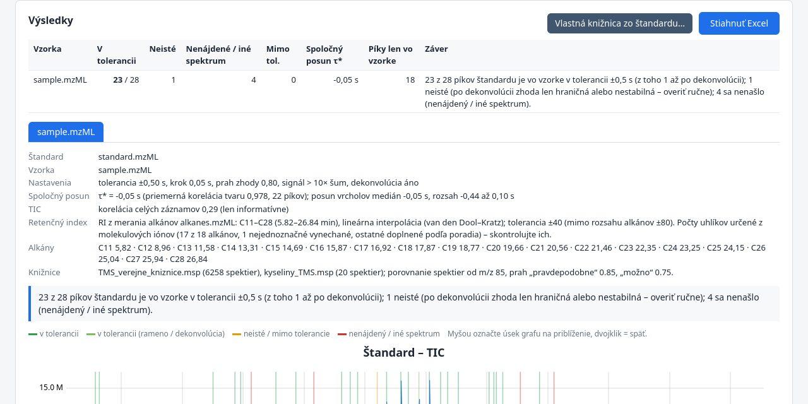
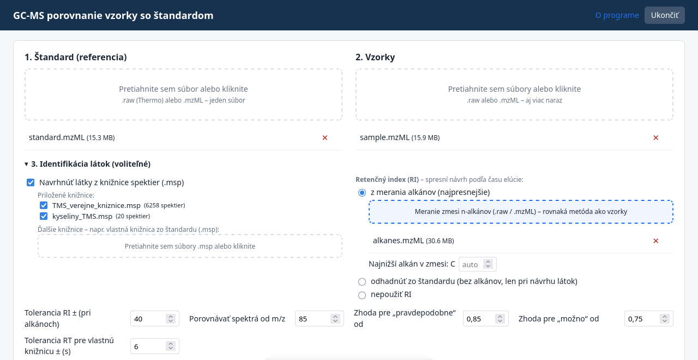
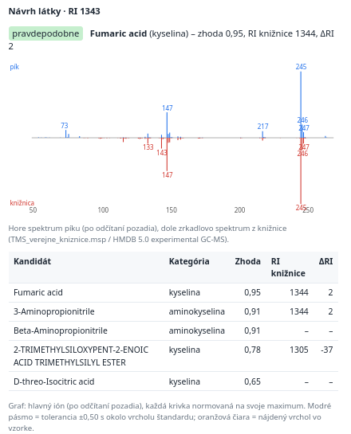

# GC-MS Sample vs. Standard Comparison

**English** · [Slovensky](README.sk.md)

A local desktop tool for GC-MS laboratories that checks, peak by peak, whether the compounds of a reference standard are present in measured samples. It reads Thermo `.raw` and `.mzML` files, aligns retention times, compares EI spectra, resolves co-eluting peaks by NMF deconvolution and optionally suggests compounds from spectral libraries with retention-index filtering. Written in C# / .NET 8 with a browser UI; data never leave the computer.

The program compares GC-MS runs of samples with a run of a standard. For every peak of the standard it checks whether the same compound is present in the sample within a retention-time tolerance (default ±0.5 s, step 0.05 s).

You see the result in your browser: a summary, a peak table, plots and a peak detail view. The whole result can be downloaded as an Excel file.

The program runs only on your computer. No files are sent anywhere and nothing has to be installed.

On first start the program asks you to accept the license of the Thermo RawFileReader library. The acceptance is stored in your user folder (`GcmsPorovnanie/licencia-thermo-prijata.txt` in the application-data directory).

The program is not a medical device. Results must always be reviewed by a qualified person using the laboratory's validated method.



<p>


</p>

*Screenshots made with anonymised runs and a synthetic n-alkane run.*

> The user interface is in Slovak. Slovak labels are given below in **bold** with an English translation.

## Starting the program

| System | Zip from [Releases](../../releases) | What to run |
|---|---|---|
| Windows 10/11 | `…-win-x64.zip` | double-click `GcmsPorovnanie.exe` |
| Mac with Apple processor (M1–M4) | `…-osx-arm64.zip` | double-click `Spustit.command` |
| Mac with Intel processor | `…-osx-x64.zip` | double-click `Spustit.command` |
| Linux (x64 / arm64) | `…-linux-x64.zip`, `…-linux-arm64.zip` | `./GcmsPorovnanie` in a terminal |

- A console window opens, then the browser with the program. If the browser does not open by itself, open the address printed in the console, e.g. `http://localhost:53712`.
- Quit the program with the **Ukončiť** (Quit) button in the browser or by closing the console window.
- Unzip the whole zip; to use the program on another computer, copy the whole folder. It must contain the program, `wwwroot`, `LICENCIE` and `kniznice`. Without `kniznice`, compound suggestions from the bundled libraries do not work. Distribute the program only complete and free of charge. Nobody may redistribute the Thermo RawFileReader library on its own (see Licenses).
- **Mac:** if you received the program from the internet or by e-mail, macOS may block it. `Spustit.command` removes this block. If that does not help, right-click `Spustit.command` and choose **Open**.
- `SHA256SUMS.txt` in each release lets you verify the downloads. The Mac binaries are ad-hoc signed.
- **Windows:** if a blue SmartScreen window appears, click **More info** and then **Run anyway**. The program is not signed with a commercial certificate.

## Usage
1. **Štandard** (standard): drag and drop or select one `.raw` (Thermo) or `.mzML` file.
2. **Vzorky** (samples): select one or more files.
3. Adjust **Nastavenia** (settings) if needed and click **Porovnať** (compare).
4. **Results:** the top table summarises all samples. Below it are tabs for the individual samples. Click a row of the peak table to see the peak detail. Zoom the plots by dragging with the mouse; double-click restores the original view.
5. **Stiahnuť Excel** (download Excel) downloads the sheet „Prehľad“ (overview: status of every peak in every sample) and, for each sample, the sheets „píky“ (peaks) and „navyše“ (sample-only peaks). When identification is switched on, columns with RI and the suggested compound are added, plus the sheet „Identifikácia“.

## Compound identification (optional)
In section **3. Identifikácia látok** (compound identification) you choose what to use. Everything is optional and the options can be combined.
- **Compound suggestions from a spectral library (.msp).** The spectrum of every standard peak and every sample-only peak is compared with the library. The comparison runs against the whole library, not only against acids. The result shows the best compound, its category (acid / amino acid / other), the match, ΔRI and further candidates. The peak detail shows a mirror plot of the two spectra.
  - The bundled libraries are in the `kniznice` folder next to the program: `TMS_verejne_kniznice.msp` (6,258 spectra of TMS derivatives) and `kyseliny_TMS.msp`. Their origin and terms of use are described in `kniznice/README.md`.
  - You can upload further `.msp` libraries, for example your own in-house library from the standard.
- **Retention index (RI)** refines the suggestion by elution time:
  - **from an n-alkane run** (most accurate). Upload a run of an n-alkane mixture measured with the same method. The program finds the alkanes by their spectrum (m/z 57, 71, 85…) and determines the carbon numbers from the molecular ions. If that is not possible, enter the lowest alkane manually. RI is calculated by linear interpolation (van den Dool–Kratz); the default tolerance is ±40;
  - **estimated from the standard.** Without alkanes, RI is estimated from confident hits in the standard (match ≥ 0.90) by a quadratic calibration. This is only a rough estimate;
  - **no RI.**
- **Suggestion status:**
  - *vlastná knižnica – zhoda* (in-house library match): the spectrum matches the in-house library within the RT/RI tolerance;
  - *pravdepodobne* (probable): match ≥ 0.85 and RI fits;
  - *možno* (possible): no RI, outside the RI range, RI at the edge of the tolerance, duplicate assignment, or match 0.75–0.85;
  - *neurčené* (undetermined).
- **In-house library from the standard.** The button **Vlastná knižnica zo štandardu…** in the results saves the standard's peaks as `.msp`: the spectrum from your instrument, RT, RI and the name you enter. Upload it among the libraries for later samples. It takes precedence over the public libraries.
- A compound suggestion is **an aid for review, not an identification**. Isomers (D/L, cis/trans, citrate/isocitrate) cannot be distinguished by their spectra.

Verification (2026-10-16): the suggestions for 46 peaks of the standard and a sample agree with an independent Python script. RI from a synthetic n-alkane run C11–C28 differs from the estimate from the standard by 0–7 units, and the carbon numbers were assigned correctly. A real alkane run has not been available yet.

## How the comparison works
- **Standard peaks** are detected in the TIC after background subtraction.
- **For each peak:**
  - its base ion is taken;
  - the shift τ ∈ [−tol, +tol] is found in steps of 0.05 s from the correlation of the peak shape; the sample is linearly interpolated;
  - the peak apex is refined by a parabola in both the standard and the sample;
  - the spectrum at the apex is compared with the standard by cosine similarity; the threshold is 0.80.
- **Result for each peak:** *v tolerancii* (within tolerance), *v tolerancii (rameno)* (within tolerance, shoulder), *v tolerancii (dekonvolúcia)* (within tolerance after deconvolution), *neisté (dekonvolúcia)* (uncertain after deconvolution), *mimo tolerancie* (outside tolerance), *iné spektrum* (different spectrum) or *nenájdený* (not found).
- **Deconvolution** is done only for doubtful peaks. A ±5 s window of the sample is factorised by non-negative matrix factorisation (NMF) into k = 2–5 components. A component found this way counts as certain if it appears for at least two values of k and its match is at least 0.85.
- **Common shift τ\*** is the maximum of the mean peak-shape correlation over the peaks within tolerance.
- **Sample-only peaks** are peaks of the sample that have no standard peak within ±tol.

The method was verified on 2026-10-16 on three runs from a Thermo ITQ 1100, and the results agree with the original Python script:
- standard against itself: 28 of 28 peaks;
- blank (hexane): 0 of 28;
- real sample: 23 of 28.

**Limitations:**
- The thresholds (0.80 / 0.85 / 10× noise) were chosen on this data set and are not validated.
- With deconvolution the numbers differ slightly between runs, because the calculation starts from random values.
- The sample-vs-standard comparison is done in retention time. RI is used only for compound suggestions.
- Only Thermo `.raw` and `.mzML` files can be read.

## Licenses
RawFileReader reading tool. Copyright © 2016 by Thermo Fisher Scientific, Inc. All rights reserved.

The Thermo Fisher RawFileReader library may be used only non-commercially. By using the program you agree not to redistribute it. The full terms are in `LICENCIE/THERMO_LICENSE.doc`.

Other components used: OpenMcdf (MPL-2.0), CommandLineParser (MIT), uPlot (MIT), ClosedXML (MIT), .NET (MIT).

The bundled spectral libraries (`kniznice/`) come from public sources (MS-DIAL/MoNA, HMDB, NIST WebBook) with their own terms of use, see `kniznice/README.md`. They are not covered by the MIT license.

---

# For developers

## Command line

```bash
# compare one standard with one or more samples, write Excel (and optionally JSON)
GcmsPorovnanie --porovnaj standard.raw sample1.raw sample2.mzML --out result.xlsx [--json result.json] [--bez-dekonvolucie]

# with compound identification: bundled or own .msp libraries, optional alkane run for RI
GcmsPorovnanie --porovnaj standard.raw sample1.raw --out result.xlsx \
    --kniznica TMS_verejne_kniznice.msp --kniznica my_library.msp \
    [--alkany alkanes.raw] [--prvy-alkan 10] [--ri alkany|odhad|ziadny] [--mz-od 85]

# dump scans (RT, TIC, binned spectrum) to CSV – useful for verifying the reader
GcmsPorovnanie --dump file.raw dump.csv
```

## Building from source

Requirements: [.NET 8 SDK](https://dotnet.microsoft.com/download/dotnet/8.0) on Windows, macOS or Linux.

```bash
# 1) get Thermo RawFileReader (not included in this repository, see "Third-party components")
bash fetch-thermo.sh            # downloads the official .NET 8 packages into ./lib

# 2) run in development mode
dotnet run -c Release

# 3) build self-contained single-file executables for all platforms
#    -> ./vystup/<rid>/ and ./vystup/GcmsPorovnanie-<version>-<rid>.zip + SHA256SUMS.txt
bash build.sh
```

**Releases via GitHub Actions.** `.github/workflows/release.yml` builds all platforms on a macOS runner whenever a tag `v*` is pushed (`git tag v1.0.0 && git push origin v1.0.0`). It fetches RawFileReader, ad-hoc signs the Mac binaries, runs a smoke test and attaches the zips to the GitHub Release. You can also start it manually from the *Actions* tab; the zips are then kept as workflow artifacts.

On Windows without bash:
1. Download `thermofisher.commoncore.data.8.0.42.nupkg` and `thermofisher.commoncore.rawfilereader.8.0.42.nupkg` from <https://github.com/thermofisherlsms/RawFileReader/tree/main/Libs/NetCore/Net8>.
2. Rename them to `.zip` and copy `lib/net8.0/*.dll` into `./lib`. Also download [`License.doc`](https://github.com/thermofisherlsms/RawFileReader/blob/main/License.doc) and save it as `lib/THERMO_LICENSE.doc`, so that it ships with your build.
3. Run `dotnet publish -c Release -r win-x64 -p:PublishSingleFile=true -p:IncludeNativeLibrariesForSelfExtract=true -o out`.

**macOS signing:** Apple Silicon only runs signed binaries.
- When you build on a Mac, the SDK signs the apphost automatically.
- `build.sh` ad-hoc signs them with `codesign` on macOS. When you cross-build on Linux, it uses [`rcodesign`](https://github.com/indygreg/apple-platform-rs) if it is on `PATH`.

### Project layout

```
GcmsPorovnanie.csproj   .NET 8 web app (ASP.NET Core minimal API, self-contained)
src/Meranie.cs          readers: Thermo .raw (RawFileReader) and .mzML (base64/zlib, 32/64-bit) → MS1 scans binned to integer m/z
src/Signal.cs           numerics matching numpy/scipy: np.interp, ndimage min/uniform filter (reflect), signal.find_peaks (prominence, width)
src/Porovnanie.cs       comparison algorithm and settings (Nastavenia)
src/Nmf.cs              NMF deconvolution
src/Kniznica.cs         .msp library reader and spectral search
src/Identifikacia.cs    alkane detection, retention index, compound suggestions
src/Excel.cs            Excel export (ClosedXML)
src/Program.cs          local web server, job queue, CLI
wwwroot/                UI (vanilla JS + uPlot)
kniznice/               bundled EI libraries (.msp) + README with sources and terms
docs/                   screenshots used in this README
fetch-thermo.sh         downloads Thermo RawFileReader into ./lib (git-ignored)
build.sh                cross-platform publish + release zips (win-x64, osx-arm64, osx-x64, linux-x64, linux-arm64)
packaging/macos/        Spustit.command launcher for macOS
.github/workflows/      release workflow (GitHub Actions)
```

## Validation

The C# implementation is a port of the original Python/NumPy/SciPy prototype. It was checked against it on three Thermo ITQ 1100 runs (a QC standard, a hexane blank, a real sample):

- **Readers.** RT, TIC and binned spectra from `.raw` (RawFileReader 8.0.42) and from `.mzML` (ThermoRawFileParser 2.0) are bit-identical to the Python pipeline.
- **Comparison.** All 28 peak statuses are identical. Deterministic quantities (RT, τ, correlations, cosine, noise) agree to < 1·10⁻⁶. NMF numbers differ slightly because of a different random generator; the statuses are unchanged.
- **Self-test.** Standard vs. itself: 28/28 within tolerance, shift 0.00 s. Hexane blank: 0/28, no false positives.

## Intended use – not a medical device

This software is a **research and laboratory support tool**. It is **not a medical device** and is not validated for diagnostic use. Its results must not be the sole basis for clinical decisions. Every finding has to be reviewed by a qualified person using the laboratory's validated method.

The Thermo Fisher RawFileReader license (section 5.3) also states that RawFileReader is not intended for uses requiring fail-safe performance ("High Risk Activities", which the license says include the operation of medical facilities) and must not be used in connection with them. Check whether your use case is affected before using it in a clinical setting.

## Limitations (technical)

- **Thresholds are not validated.** 0.80 / 0.85 cosine and 10× noise were chosen on a small data set. Tune them for your method (all are exposed in the UI).
- **Sample-vs-standard comparison is in retention time.** RI is used only for compound suggestions. RI estimated from the standard (without alkanes) is only a rough guess.
- **Compound suggestions are not identifications.** Isomers (D/L, cis/trans, citrate/isocitrate) cannot be distinguished by EI spectra. Ion-trap spectra differ slightly from library spectra (mostly quadrupole/TOF).
- **Simple NMF.** It is not a full deconvolution package such as AMDIS or eRah. It is used only for doubtful peaks, and its results depend on random initialisation.
- **Data and vendors.** MS1 only, unit-mass binning (integer m/z). Vendor formats other than Thermo `.raw` must be converted to `.mzML` first, e.g. with ProteoWizard msconvert.

## Background / references

- Eilers P.H.C. (2004) *Parametric time warping.* Anal. Chem. 76:404–411. doi:10.1021/ac034800e
- Nielsen N.-P.V., Carstensen J.M., Smedsgaard J. (1998) *Aligning of single and multiple wavelength chromatographic profiles … correlation optimised warping.* J. Chromatogr. A 805:17–35. doi:10.1016/S0021-9673(98)00021-1
- Stein S.E. (1999) *An integrated method for spectrum extraction and compound identification from GC/MS data* (AMDIS). J. Am. Soc. Mass Spectrom. 10:770–781. doi:10.1016/S1044-0305(99)00047-1
- Domingo-Almenara X. et al. (2016) *eRah: a computational tool integrating spectral deconvolution and alignment …* Anal. Chem. 88:9821–9829. doi:10.1021/acs.analchem.6b02927
- Lee D.D., Seung H.S. (2001) *Algorithms for non-negative matrix factorization.* NIPS 13.

## Third-party components

| Component | License | Notes |
|---|---|---|
| Thermo Fisher **RawFileReader** 8.0.42 | Thermo Fisher proprietary license ([License.doc](https://github.com/thermofisherlsms/RawFileReader/blob/main/License.doc)) | **Not included in this repository.** Fetched by `fetch-thermo.sh` from the official repository. Key terms (summary, the license text prevails): may be redistributed only together with your own software (1.2); no decompiling, reverse engineering or reflection (2.1); distributors must show the notice *"RawFileReader reading tool. Copyright © 2016 by Thermo Fisher Scientific, Inc. All rights reserved."* in the About box (3.2) and make end users agree not to redistribute it (3.3); no commercial exploitation (charging fees, licensing for consideration) without Thermo's written consent (4.2); must not be combined with GPL-type licenses (4.3); not for High Risk Activities (5.3). The app shows the notice under *O programe* (About) and asks the user to accept these terms on first start. |
| OpenMcdf 3.1.4 | MPL-2.0 | dependency of RawFileReader |
| CommandLineParser 2.9.1 | MIT | dependency of RawFileReader |
| ClosedXML 0.105 | MIT | Excel export |
| uPlot 1.6.31 | MIT | plots (`wwwroot/uPlot.*`) |
| .NET 8 / ASP.NET Core | MIT | runtime |
| Bundled EI libraries (`kniznice/`) | terms of the original sources (MS-DIAL/MoNA, HMDB, NIST WebBook) | see `kniznice/README.md`; not covered by the MIT license |

Because of the RawFileReader terms, **prebuilt binaries that contain it must not be commercially exploited** (e.g. sold or licensed for a fee) without Thermo Fisher's written consent. Their users must not redistribute RawFileReader. The project's own source code is released under the license below. If you fork it, keep it free of GPL-type code, because the RawFileReader license forbids that combination.

## Contributing

Issues and pull requests are welcome. Please **never attach real measurement files** to issues: `.raw` and `.mzML` files contain sample names and may contain patient data. Use anonymised or synthetic data, or describe the problem with the CLI `--dump` output.

## Author

Developed by **Martin Pohorelský** ([martenech](https://github.com/martenech)).

## License

Source code of this project: **MIT License**, see [`LICENSE`](LICENSE). This does not cover Thermo Fisher RawFileReader or the bundled spectral libraries (see above).
